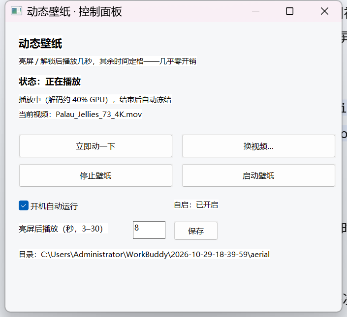
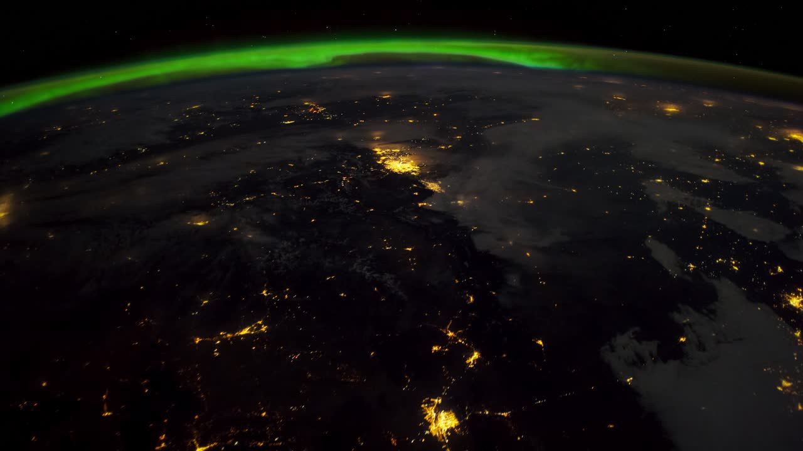
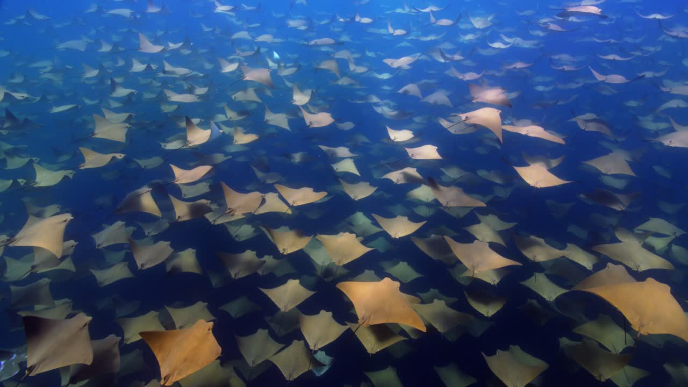

# AerialWallpaper · Windows 动态视频壁纸

把 macOS 风格的官方航拍视频搬上 Windows 桌面：**亮屏/解锁/回到电脑时播放几秒，其余时间定格**——有动态画面的观感，却几乎零开销。



| | | |
|---|---|---|
|  |  |  |
|  |  | |

## 特性

- **真·桌面层视频**：窗口挂进 Progman 的子 WorkerW，图标正常点击、不影响使用（宿主线程消息泵 P50 响应 0.02ms）
- **低功耗播放策略**：亮屏 / 解锁 / 空闲回归时自动播放 N 秒后定格，GPU 解码归零、CPU 占用 < 0.1%（单核）
- **片库在线点播**：内置 Apple 官方 4K 航拍片单（89 条，含极光、冰川、沙漠、水母、鲸群、桂林山水等），12 线程并发下载约 9MB/s
- **热切换**：换视频不重启、不闪屏，3 秒生效
- **无缝启动**：登录 / 换片时先把系统静态壁纸换成该片首帧海报，等 mpv 渲染出画面再露出视频窗口——静态到动态之间肉眼无跳变，不会“先露原壁纸再闪一下”
- **原壁纸记忆**：首次启动记下你原来的静态壁纸，停止壁纸时自动还原
- **Win32 原生控制面板**：纯 ctypes，无第三方 Python 依赖（无 tkinter 也能跑）
- **面板内置视频库**：右侧列表列出全部 53 条视频，点击即看缩略图预览，双击/按钮切换壁纸，不用再翻文件对话框
- **一键打包**：PyInstaller 出 8MB 单文件 exe，另附便携包制作

## 系统要求

- Windows 10 / 11（在 Win11 26H2 4K@150% 上开发测试）
- Python 3.8+（源码运行；标准库即可，无需 pip install）
- [mpv](https://mpv.io/installation/)：任意 Windows 构建，放到 `mpv\mpv.exe`，或在 `config.json` 里指定路径

## 快速开始（源码）

```bat
git clone https://github.com/bibibibibibibibi/AerialWallpaper.git
cd AerialWallpaper
python fetch_aerial.py --list          # 浏览片库（44 条自然类 / 全部 89 条）
python fetch_aerial.py --get 73 --apply   # 下载“帕劳水母湖”并立即设为壁纸
```

`--apply` 会自动写配置并启动播放器。此后每次亮屏/解锁都会自动播放。

下载 mpv 后放至 `mpv\mpv.exe`（若尚未放置，播放器会在启动时报错提示）。

## 快速开始（exe）

从 [Releases](../../releases) 下载 `AerialWallpaper.exe`（约 8MB，含控制面板 + 后台播放器）：

| 命令 / 操作 | 效果 |
|---|---|
| 双击 exe | 打开控制面板 |
| `AerialWallpaper.exe --run` | 后台播放（开机自启用） |
| `AerialWallpaper.exe --install` / `--uninstall` | 注册 / 移除登录自启（计划任务） |
| `AerialWallpaper.exe --stop` / `--status` | 停止 / 查看状态 |

> exe 不内嵌视频（版权与体积原因），首次使用请用 `fetch_aerial.py` 下载任意一条，或手动放置 mp4/mov 后在控制面板点「换视频…」。

## 打包自己的 exe

```bat
pip install pyinstaller
pyinstaller AerialWallpaper.spec
```

## 播放逻辑：什么时候动、什么时候停

壁纸播放器只有两个运行状态（外加整体退出），规则全部列在下面，没有隐藏行为。

**核心原则：暂停原因按「来源」分别记录，各自的事件才解除各自的暂停。**
熄屏只由亮屏解除，锁屏只由解锁解除，屏保只由屏保退出解除。
内部事件（定时动一下、换片、面板保存设置）**不会**解除暂停——否则黑屏/屏保后面会偷偷解码。

**「动」——以下任一时刻开始播放（播放 `回到桌面后播放` 设定的秒数，然后自动定格）：**

| 触发 | 说明 |
|---|---|
| 亮屏 | 显示器从灭到亮（解除熄屏暂停） |
| 解锁 / 切回会话 | 锁屏界面输密码回到桌面、远程会话切回（解除锁屏暂停） |
| 屏保退出 | 专用恢复通道，只解除屏保暂停；若屏幕此时已熄屏/锁屏则继续暂停 |
| 面板「立即动一下」 | 用户明确要看画面，解除全部暂停并播放一轮 |
| 换视频 / 启动壁纸 | 新画面出现时先动一轮让你看清 |
| 空闲很久后回来 | 无人操作超过 `config.json` 的 `idle_trigger_seconds`（默认 300 秒=5 分钟）后重新有输入，才播一次。**工作中几十秒的停顿不会触发** |

**「定格」（停止解码，画面停在当前帧，GPU 归零）：**

| 触发 | 说明 |
|---|---|
| 播满设定的秒数 | 默认行为；「让壁纸一直动」勾选后此条失效 |
| 锁屏 | 黑屏界面后面不需要 4K 解码，立刻定格；解锁后恢复 |
| 熄屏 | 同上；亮屏后恢复 |
| 屏保运行中 | 画面让给屏保，屏保退出后恢复 |

**退出：** 面板「停止壁纸」= 播放器进程整个退出，桌面定格为退出瞬间的画面（不是恢复原静态壁纸）；「启动壁纸」重新拉起（已在运行时点它会提示，不会重复启动）。

**「让壁纸一直动」勾选后的语义**：持续播放、不按秒数定格，但**锁屏 / 熄屏 / 屏保期间仍然暂停**（屏幕看不见时没必要解码），回到桌面自动恢复。

## 视频素材版权说明

片库索引与视频均来自 Apple 官方空中壁纸 CDN（`sylvan.apple.com`），版权归 Apple 所有。
本项目**不存储、不再分发任何视频文件**，仅提供指向官方 CDN 的下载工具，供个人桌面壁纸使用。
请不要将下载的视频用于商业用途或二次分发。

mpv 为 GPLv2+ 软件，请遵循其许可证；本项目代码不包含、不修改 mpv 源码。

## 目录结构

```
AerialWallpaper/
├── app.py                 # 控制面板 + CLI 入口（--run/--install/--stop/--status）
├── wallpaper_player.py    # 核心播放器：WorkerW 挂载、电源/会话监听、状态机
├── switch_video.py        # 换片 / 启停 / 状态查询
├── fetch_aerial.py        # Apple 片库浏览与 12 线程分片下载
├── install.py             # 安装 / 卸载 / 便携打包辅助
├── make_shortcut.py       # 纯 ctypes 创建 .lnk 快捷方式
├── AerialWallpaper.spec   # PyInstaller 配置
├── assets/                # 图标 + Apple 片单 tar（1.6MB）
└── docs/screenshots/      # 预览图
```

## 已知限制

- 仅支持单显示器主屏（多屏未适配）
- Windows 10/11 的桌面层实现在版本间差异较大，如壁纸不显示可开 issue 反馈系统版本
- 锁屏界面不可见（锁屏是独立层），仅在登录后的桌面生效

## 更新日志

**v1.15（2026-11-18）**
- **彻底现代化视觉，去除"破旧复古感"**：弃用经典 Windows 原生控件外观，改为
  `WS_POPUP` 无边框窗口 + 圆角区域 + DWM 投影，顶部完全自绘标题栏（应用标记、
  标题/副标题、状态胶囊、最小化/关闭按钮，可拖动）。
- **自绘圆角复选框**：蓝色方块 + 白色对勾替代老式方框，兼容 BM_GETCHECK/
  BM_SETCHECK/BM_CLICK；播放秒数输入框改为圆角浅灰底无边框。
- **冷色系配色**：靛蓝主色、冷灰白背景、纯白卡片，按钮/列表悬停与选中态更统一。

**v1.14（2026-11-18）**
- **布局重排，消除浪费空间**：左右两栏统一从 y=84 排到 y=580、底部齐平，窗口高度
  收紧到 960×624；左栏三张卡片与右栏列表/预览/按钮高度重新分配，控件间距均匀。
- **删除「目录：…」行**：它显示的是程序安装目录而非视频库位置，对用户无意义且误导。
- **状态胶囊移到左栏标题右侧**：右栏「视频库」标题得以完整显示，不再被挤窄让位。

**v1.13（2026-11-18）**
- **面板视觉重新设计**：浅色卡片式布局 + 圆角描边、状态胶囊（右上角圆点+文字）、
  自绘按钮（主按钮实心蓝、次按钮描边，含悬停/按下态）、自绘视频列表（选中行浅蓝圆角）。
  新增 `app.manifest` 启用 comctl32 v6 现代控件样式与 PerMonitorV2 DPI 感知。
- 修复自绘文字用 OPAQUE 背景导致的白字白底块；修复自绘列表项用 itemData 取文字
  （LBS_HASSTRINGS 下恒为 0）导致列表空白；修复状态胶囊被标题 STATIC 遮挡的问题。
- 构建 spec 加入 manifest，`test_panel.py` 补齐 winreg 导入。

**v1.12（2026-11-18）**
- **删除「换视频…」按钮**：面板右侧视频库（双击设为壁纸）已完全覆盖它的功能，
  文件对话框路径绕且只能看到单个文件，留着一个按钮反而让人困惑。
- **「停止壁纸 / 启动壁纸」合并为一个智能切换按钮**：运行中显示「停止壁纸」
  （点击=定格退出），已停止显示「启动壁纸」（点击=重新接管桌面）。文字随
  运行状态每秒自动刷新，不会再出现"点了启动却提示已在运行"的歧义。

**v1.11（2026-11-18）**
- **修复「面板切换不反应」**（IPC 层重写）：播放器与 mpv 的通信从「长连接只写
  不读」改为一次性连接 RPC（连接→发命令→按回执确认→关闭）。旧架构下 mpv 的
  客户端线程会被事件流写满缓冲后连命令也不读，`pipe.write` 永久阻塞 → 主循环
  冻结（实测卡死 99 秒），面板所有操作没反应、暂停/换片事件全部被吞。
  现在每条命令有回执确认，主循环每 200ms 响应一次，换片 1 秒内就地生效。
- 暂停/恢复/换片全部回执确认制：mpv 没收到就自动重试，不再静默丢失。
- 新增慢迭代看门狗（单次循环 >5 秒留痕），支持 py-spy 在线诊断线程状态。

**v1.10（2026-11-17）**
- **暂停按来源分别记录**（blockers 集合）：熄屏只由亮屏解除、锁屏只由解锁解除、
  屏保只由屏保退出解除；换片/nudge/定时动一下等内部事件绝不解除暂停，
  杜绝"黑屏/屏保后面偷偷解码"。
- 空闲兜底阈值 20 秒 → 300 秒：工作中停顿一下不再触发播放。
- 屏保退出改用专用事件通道；修复单实例互斥体句柄被 GC 回收。
- 面板「一直动」文案统一；「启动壁纸」运行中不再误报已启动。
- 新增 `test_state_machine.py`（18 用例）。

**v1.9（2026-11-17）**
- **面板内置视频库**：右侧新增视频列表（自动扫描视频目录，本例 53 条）+
  缩略图预览（点击即显示，GDI+ 自绘），双击视频或点「使用此视频」即刻切换壁纸。
  缩略图由 `make_thumbs.py` 用 ffmpeg 批量生成到视频目录的 `.thumbs\` 子目录
  （320×180 JPG，53 条约 1 分钟）；没有缩略图的视频仍可正常切换。
- **锁屏即定格**：之前锁屏后视频会在黑屏界面后面继续解码 4K 直到熄屏，
  浪费电和 GPU。现在锁屏事件直接暂停（解锁后照常恢复播放）。
- **播放逻辑梳理**：面板文案从「亮屏后播放」统一改为「回到桌面后播放」
  （真实触发是亮屏/解锁/屏保退出的任一种，旧文案让人误以为只看亮屏）；
  「一直动」的提示改为如实描述——锁屏/熄屏/屏保期间仍会暂停。
  README 新增「播放逻辑」一节，完整列出动/停的全部触发条件。

**v1.7（2026-11-17）**
- 「换视频…」对话框现在默认打开当前壁纸视频所在目录（视频库移到独立
  存储盘后无需再一层层手动翻找）；若当前配置无效则回退到
  `X:\动态壁纸视频`，最后回退程序目录。

**v1.6（2026-11-04）**
- 修复「停止壁纸」后桌面偶尔定格回首帧海报、而不是当前画面：mpv 把 4K 帧
  编码写盘可能超过原先固定的 0.6 秒等待，文件还没落盘就退回了首帧海报。
  现在改为轮询等待截图写完（最多 3 秒），停止时定格的就是眼前这一帧。
- 「立即动一下」的操作反馈显示具体的播放秒数（与设置的亮屏秒数一致）。
- 新增 `test_panel.py` 面板端到端回归测试：BM_CLICK 驱动真实面板按钮，
  覆盖保存 / 立即动一下 / 一直动 / 停止 / 启动 / 换视频 / 安装屏保与组合场景。
  踩坑记录：跨进程写 Edit 控件必须发 `WM_SETTEXT` 消息——`SetWindowTextW`
  只更新系统缓存的文本副本，控件真实文本（面板进程内读到的）并不会变。

**v1.5（2026-11-04）**
- 修复「壁纸一直播放时系统不进屏保/不息屏」：mpv 默认 `--stop-screensaver=yes`，
  播放期间不断向系统申请保持唤醒，把屏保和息屏都挡住了。
  壁纸与屏保的 mpv 均改为 `--no-stop-screensaver`，视频播放不再影响系统空闲判定。

**v1.4（2026-11-04）**
- 新增屏幕保护程序：控制面板点「安装屏保」，把 exe 复制为 `AerialScreensaver.scr`
  并写入系统屏保设置（默认 10 分钟触发，可在 Windows 屏保设置里调整）。
- 屏保全屏置顶播放（与壁纸共用视频库），鼠标移动 / 任意按键 / 点击即退出。
- 屏保运行期间动态壁纸自动暂停（省一路 4K 解码），退出后自动恢复。
- 屏保设置里的「设置」按钮会显示说明；小窗预览也已适配（`/p`）。

**v1.3（2026-11-04）**
- 控制面板新增「让壁纸一直动」开关：开启后壁纸持续播放、不再定时定格，
  只有熄屏时暂停，亮屏自动恢复；状态每秒热更新，无需重启。
- 默认仍为"亮屏播放几秒后定格"的省电模式，两种模式随时切换。

**v1.2（2026-11-03）**
- 锁屏/待机回来后接着上次的位置播，不再从头开始。
  解锁会重建宿主窗口，mpv 随之重启，位置自然归零。
  现在暂停时记录 `time-pos`（播放中每 3 秒采样一次兜底），
  重建时用 `--start=<上次位置>` 续播，日志会打出 `resume at 9.41s`。
  位置查询走独立的 IPC 连接，不占用主连接、不阻塞消息循环。
- 换片后位置自动失效，新视频仍从 0 开始

**v1.1（2026-11-02）**
- 修复锁屏解锁后先冒出一个独立播放窗口、再切回桌面背景的问题。
  解锁时 Windows 会换掉桌面 WorkerW，宿主窗口被连带销毁；旧逻辑先走
  "mpv 退出 → 重启"分支，拿失效的 `--wid` 起新 mpv，mpv 就自建了顶层窗口。
  现在把宿主存活检查提到循环最前面（200ms 一次），失效即整体重建；
  启动/重启前校验窗口有效性；并对 mpv 进程做 6 秒顶层窗口巡检兜底。
  重建期间桌面保持当前视频的定格帧，不会闪黑。
- 重建时不再重复设置同一张静态壁纸，缩短解锁后的空窗期

**v1.0（2026-10-30）**
- 修复换视频时冒出独立 mpv 播放窗口（复用桌面层 + 就地 loadfile 换片，无窗口闪现）
- 控制面板改造：停止/启动/立即动一下改走命名事件（毫秒级、跨启动方式有效）；
  亮屏秒数保存即时生效；自启复选框修复（此前勾上反而会删任务）；
  自启状态改为后台检查，面板秒开即响应；操作反馈在面板上直接显示
- 无缝启动：首帧海报接力 + 视频窗口延迟显示，消除登录/换片时的闪屏
- 原静态壁纸记忆与还原
- 新视频缺海报时自动用 mpv 截首帧补齐（不依赖 ffmpeg）
- 修复控制面板 64 位句柄溢出（`ReleaseDC` OverflowError）与 `FillRect` 库归属
- 修复控制面板窗口创建后不可见（缺 `WS_VISIBLE`），并加单实例唤醒
- 修复 exe 双击时多余弹出黑控制台

**v0.9**
- 首版：WorkerW 挂载、亮屏/解锁触发播放、片库下载、热切换

## License

MIT — 详见 [LICENSE](LICENSE)。视频素材版权归 Apple，见上文说明。
