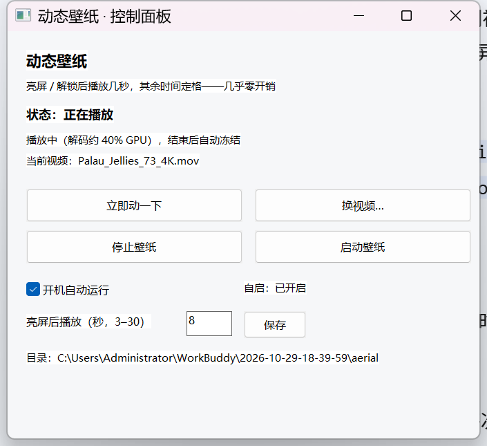
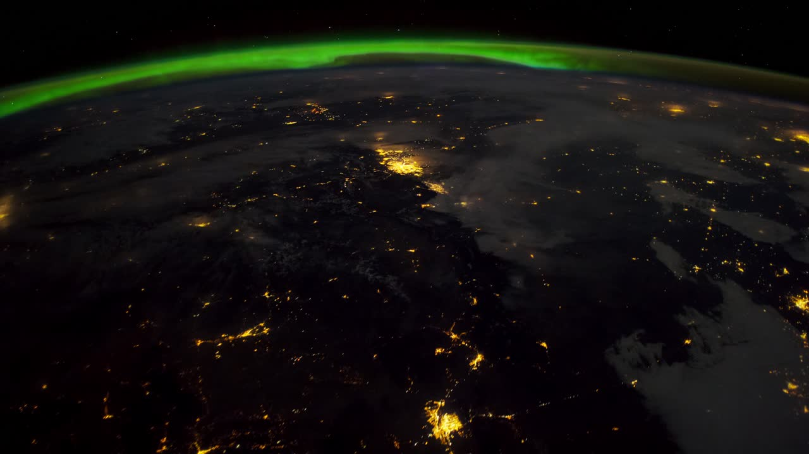
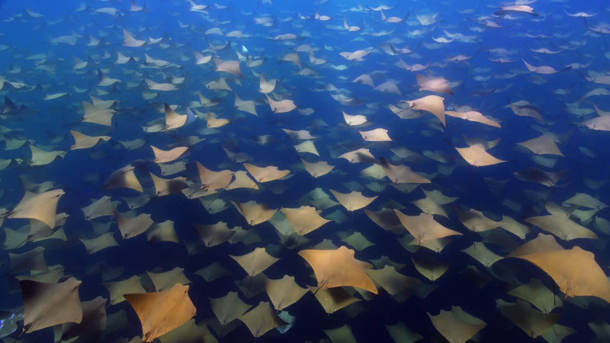

# AerialWallpaper · Windows 动态视频壁纸

把 macOS 风格的官方航拍视频搬上 Windows 桌面：**亮屏/解锁/回到电脑时播放几秒，其余时间定格**——有动态画面的观感，却几乎零开销。



| | | |
|---|---|---|
|  |  |  |
|  |  | |

## 特性

- **真·桌面层视频**：窗口挂进 Progman 的子 WorkerW，图标正常点击、不影响使用（宿主线程消息泵 P50 响应 0.02ms）
- **低功耗播放策略**：亮屏 / 解锁 / 空闲回归时自动播放 N 秒后定格，GPU 解码归零、CPU 占用 < 0.1%（单核）
- **片库在线点播**：内置 Apple 官方 4K 航拍片单（89 条，含极光、冰川、沙漠、水母、鲸群、桂林山水等），12 线程并发下载约 9MB/s
- **热切换**：换视频不重启、不闪屏，3 秒生效
- **无缝启动**：登录 / 换片时先把系统静态壁纸换成该片首帧海报，等 mpv 渲染出画面再露出视频窗口——静态到动态之间肉眼无跳变，不会“先露原壁纸再闪一下”
- **原壁纸记忆**：首次启动记下你原来的静态壁纸，停止壁纸时自动还原
- **Win32 原生控制面板**：纯 ctypes，无第三方 Python 依赖（无 tkinter 也能跑）
- **一键打包**：PyInstaller 出 8MB 单文件 exe，另附便携包制作

## 系统要求

- Windows 10 / 11（在 Win11 26H2 4K@150% 上开发测试）
- Python 3.8+（源码运行；标准库即可，无需 pip install）
- [mpv](https://mpv.io/installation/)：任意 Windows 构建，放到 `mpv\mpv.exe`，或在 `config.json` 里指定路径

## 快速开始（源码）

```bat
git clone https://github.com/bibibibibibibibi/AerialWallpaper.git
cd AerialWallpaper
python fetch_aerial.py --list          # 浏览片库（44 条自然类 / 全部 89 条）
python fetch_aerial.py --get 73 --apply   # 下载“帕劳水母湖”并立即设为壁纸
```

`--apply` 会自动写配置并启动播放器。此后每次亮屏/解锁都会自动播放。

下载 mpv 后放至 `mpv\mpv.exe`（若尚未放置，播放器会在启动时报错提示）。

## 快速开始（exe）

从 [Releases](../../releases) 下载 `AerialWallpaper.exe`（约 8MB，含控制面板 + 后台播放器）：

| 命令 / 操作 | 效果 |
|---|---|
| 双击 exe | 打开控制面板 |
| `AerialWallpaper.exe --run` | 后台播放（开机自启用） |
| `AerialWallpaper.exe --install` / `--uninstall` | 注册 / 移除登录自启（计划任务） |
| `AerialWallpaper.exe --stop` / `--status` | 停止 / 查看状态 |

> exe 不内嵌视频（版权与体积原因），首次使用请用 `fetch_aerial.py` 下载任意一条，或手动放置 mp4/mov 后在控制面板点「换视频…」。

## 打包自己的 exe

```bat
pip install pyinstaller
pyinstaller AerialWallpaper.spec
```

## 视频素材版权说明

片库索引与视频均来自 Apple 官方空中壁纸 CDN（`sylvan.apple.com`），版权归 Apple 所有。
本项目**不存储、不再分发任何视频文件**，仅提供指向官方 CDN 的下载工具，供个人桌面壁纸使用。
请不要将下载的视频用于商业用途或二次分发。

mpv 为 GPLv2+ 软件，请遵循其许可证；本项目代码不包含、不修改 mpv 源码。

## 目录结构

```
AerialWallpaper/
├── app.py                 # 控制面板 + CLI 入口（--run/--install/--stop/--status）
├── wallpaper_player.py    # 核心播放器：WorkerW 挂载、电源/会话监听、状态机
├── switch_video.py        # 换片 / 启停 / 状态查询
├── fetch_aerial.py        # Apple 片库浏览与 12 线程分片下载
├── install.py             # 安装 / 卸载 / 便携打包辅助
├── make_shortcut.py       # 纯 ctypes 创建 .lnk 快捷方式
├── AerialWallpaper.spec   # PyInstaller 配置
├── assets/                # 图标 + Apple 片单 tar（1.6MB）
└── docs/screenshots/      # 预览图
```

## 已知限制

- 仅支持单显示器主屏（多屏未适配）
- Windows 10/11 的桌面层实现在版本间差异较大，如壁纸不显示可开 issue 反馈系统版本
- 锁屏界面不可见（锁屏是独立层），仅在登录后的桌面生效

## 更新日志

**v1.0（2026-10-30）**
- 修复换视频时冒出独立 mpv 播放窗口（复用桌面层 + 就地 loadfile 换片，无窗口闪现）
- 无缝启动：首帧海报接力 + 视频窗口延迟显示，消除登录/换片时的闪屏
- 原静态壁纸记忆与还原
- 新视频缺海报时自动用 mpv 截首帧补齐（不依赖 ffmpeg）
- 修复控制面板 64 位句柄溢出（`ReleaseDC` OverflowError）与 `FillRect` 库归属
- 修复控制面板窗口创建后不可见（缺 `WS_VISIBLE`），并加单实例唤醒
- 修复 exe 双击时多余弹出黑控制台

**v0.9**
- 首版：WorkerW 挂载、亮屏/解锁触发播放、片库下载、热切换

## License

MIT — 详见 [LICENSE](LICENSE)。视频素材版权归 Apple，见上文说明。
